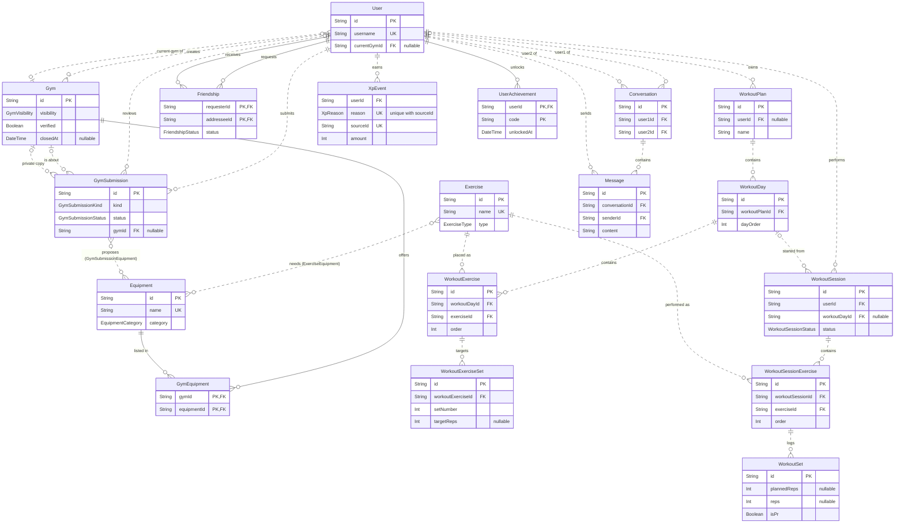

*This project has been created as part of the 42 curriculum by aelbour, abel-had, zyahansa, mouarar, sabadri.*

# Gym App — ft_transcendence

## Description

Gym App is a five-person, full-stack social fitness platform built for the 42 `ft_transcendence` project (subject v21.1). It connects one loop:

```text
Discover a gym → plan a workout → train and log sets → review progress → earn achievements → interact with friends
```

The scope stays on this loop. AI coaching, social feeds and workout recommendations are out of scope.

### Key features

- Secure email/password authentication and first-login onboarding
- Own profile, avatar, OAuth, legal pages, and multi-user correctness
- Gym discovery, details, equipment, search, filtering, sorting, and pagination
- Canonical exercise catalog with muscle groups, equipment, and exercise types
- Custom workout plans, workout days, ordered exercises, and planned sets
- Empty or planned workout sessions with historical snapshots
- Type-aware set logging, workout completion with a summary, volume and basic PRs, and the last workout of each day on Home
- Friends, presence, real-time chat, and message history
- XP, achievements, and leaderboard
- Responsive custom design system, tested in Chrome, Firefox and Edge

## Features by area

- React/Vite/TypeScript frontend, Express/TypeScript backend, PostgreSQL through Prisma, Docker Compose
- Auth: email/password with email code, Google OAuth, refresh/logout/session check, onboarding, admin navigation for the ADMIN role
- Profile: own profile, settings with metric or imperial units, avatar (image content checked with Sharp), public profile, Privacy and Terms pages
- Gyms: search, details, current gym, private gyms, gym submissions with photos, "My submissions", admin review (approve, or reject with a reason)
- Workouts (S3): plans, days, day editor, exercise picker (search, filters, sort, gym filter, pagination), active workout (add, move and remove exercises; add, edit and tick sets), finish with PRs (bodyweight sets included) and XP, weights in kg or lb and distances in km or mi, next workout on Home
- Progress: summary, leaderboard, achievements, weekly stats on Home
- Social: friends, requests, blocking, user search, conversations, WebSocket chat with presence and read receipts, connection and message size limits

The full endpoint list is in [`docs/api.md`](docs/api.md).

## Technical stack

| Layer | Technology | Why |
|---|---|---|
| Frontend | React 19, React Router, Vite, TypeScript, Tailwind CSS | Component UI, typed client code, fast builds, responsive styling |
| Backend | Node.js, Express 5, TypeScript, Zod | Explicit HTTP API and runtime validation |
| Data | PostgreSQL, Prisma 6 | Relational integrity, migrations, typed database access |
| Infrastructure | Docker Compose, GitHub | Reproducible services and collaborative review |

The application is a modular monolith: one frontend, one Express backend, one PostgreSQL database, and domain modules inside the shared applications. It is not a microservice system.

## Supported browsers

The latest stable Google Chrome, Mozilla Firefox and Microsoft Edge. Every feature was tested in each of the three browsers, with the same layout and behaviour; no browser-specific limitations were found.

## Instructions

### Prerequisites

- Git
- Docker Engine with Docker Compose v2
- Node 24 (only to run build/lint outside Docker; `nvm use` reads `.nvmrc`)
- A local `.env` derived from the committed non-secret example

### Setup

```bash
git clone https://github.com/shank187/ft_transcendence.git
cd ft_transcendence
cp .env.example .env
```

Fill every required value with local credentials. Never commit `.env` or real secrets. Compose refuses to start while a required value (database, JWT secrets, SMTP, URLs) is missing.

### Start

```bash
make
```

Equivalent current command:

```bash
docker compose up -d --build
```

Open the application at **https://localhost:4438**.

Default development ports currently exposed:

- Nginx HTTPS: `4438` on the host, forwarded to `443` inside the container
- PostgreSQL: `5432`
- Prisma Studio: `5555` when started with `make db-studio`

Frontend `5173` and backend `3000` are internal container ports reached through Nginx.
Set `FRONTEND_URL` and `VITE_API_URL` to `https://localhost:4438` and
`GOOGLE_REDIRECT_URI` to `https://localhost:4438/api/auth/google/callback`.
In the Google OAuth client settings, register `https://localhost:4438` as an
authorized JavaScript origin and the same callback URL as an authorized redirect URI.

Ports and public development URLs are configuration, not secrets. Passwords, tokens, private keys, and deployment credentials are secrets.

### Verification

```bash
docker compose ps
docker compose logs backend
docker compose logs frontend
```

Run narrow checks inside the relevant service or local environment:

```bash
cd frontend && npm run build && npm run lint
cd backend && npm run build && npm run prisma:validate
```

Outside Docker, `npx prisma generate` needs `DATABASE_URL`: copy `backend/.env.example` to `backend/.env` and fill it first.

## Architecture and documentation

- [`docs/architecture.md`](docs/architecture.md) — system boundaries, slices, request flow, and contracts
- [`docs/api.md`](docs/api.md) — implemented endpoints and API conventions
- [`docs/contracts.md`](docs/contracts.md) — what S2, S3 and S5 rely on from each other
- [`docs/database-relationships.md`](docs/database-relationships.md) — focused schema diagrams and delete rules
- [`docs/database.md`](docs/database.md) — current schema mental model and historical-data rules
- [`docs/development.md`](docs/development.md) — branch, review, verification, and environment workflow
- [`docs/pr-guide.md`](docs/pr-guide.md) — PR shape, naming, and the required PR description
- [`docs/SCOPE_AND_VALIDATION.md`](docs/SCOPE_AND_VALIDATION.md) — product scope, 14-point module plan, and team cutoffs
- [`docs/UPGRADE.md`](docs/UPGRADE.md) — October 2026 dependency upgrade: what changed, what to run after pulling, what is deferred

The executable sources remain authoritative for current implementation details:

- `frontend/src/App.tsx`
- `backend/src/app.ts`
- `backend/prisma/schema.prisma`
- `docker-compose.yml`
- `Makefile`

## Team information

| Member | Login | Role | Slice/responsibility |
|---|---|---|---|
| Aymane El Bour | `aelbour` | Technical Lead / Architect; Developer | Architecture/review and S3 Workout Planning & Execution |
| Abdelhamid El Haddadi | `abel-had` | Project Manager; Developer | S1 Platform & Identity |
| Salaheddine Badri | `sabadri` | Product Owner; Developer | S5 Progress & Gamification |
| Zyad Ahansal | `zyahansa` | Developer | S2 Gym Discovery & Equipment |
| Mohamed Ouarar | `mouarar` | Developer | S4 Social & Real-Time Interaction |

### Project management

- Trello until 13 October 2026, then [`docs/SCOPE_AND_VALIDATION.md`](docs/SCOPE_AND_VALIDATION.md): scope, priorities, ownership, and integration gates
- GitHub branches and pull requests: implementation and peer review
- Discord/team meetings: decisions and blocker escalation
- Vertical slices: each owner delivers frontend → API → service → Prisma → PostgreSQL flows

## Features List

- **User Interaction (`mouarar`, S4).** Users can search for and view public profiles, send and respond to friend requests, view and remove friends, and block or unblock users. Friends can exchange direct messages and load previous messages from their conversation history.
- **Real-Time Features (`mouarar`, S4, with S1 infrastructure).** The React app connects to the Node backend over WebSocket for live messages, read receipts, online presence, and friendship updates. The backend authenticates each socket and sends events to the affected users' connected sessions. HTTP endpoints load saved conversations and message history. Nginx handles HTTPS and forwards the WebSocket upgrade.
- **Workout plans and days (`aelbour`, S3).** Users create, rename and delete up to 3 plans, each with up to 7 named days.
- **Day editor (`aelbour`, S3).** Users pick up to 20 exercises for a day, order them, and give each up to 20 sets with targets that match the exercise type (weight and reps, reps, time or distance). Save sends the whole day at once.
- **Exercise search (`aelbour`, S3).** The 318-exercise catalog can be searched by name, filtered by muscle, equipment and "available at my gym", sorted A–Z or Z–A, and paged.
- **Active workout (`aelbour`, S3).** Users start an empty workout or a plan day (the day's targets are copied into the workout), then add, move and remove exercises, add and delete sets, enter values and tick sets. A ticked set that beats the exercise's earlier best shows a PR badge. One workout can be in progress per user.
- **Finish and summary (`aelbour`, S3; XP by `sabadri`, S5).** Finishing needs one ticked set. The summary shows time, sets, volume, exercises and PRs, and XP is given once even if Finish is sent twice.
- **Units (`aelbour`, S3).** Weight in kg or lb and distance in km or mi, from the user's setting. The database always stores kg and meters.
- **Next workout on Home (`aelbour`, S3).** Home shows the next day of the user's plan with Start, Resume or Add exercises, the last time that day was done, and the target to beat.

## Modules — 14 points

| Module | Size | Points | Primary ownership |
|---|---:|---:|---|
| Frontend + Backend Frameworks | Major | 2 | Shared |
| ORM | Minor | 1 | Shared/database |
| Standard User Management | Major | 2 | S1 + S4 |
| User Interaction | Major | 2 | S4 |
| Real-Time Features | Major | 2 | S4 + S1 infrastructure |
| Advanced Search | Minor | 1 | S2 + S3 |
| Custom Design System | Minor | 1 | Shared frontend |
| Gamification | Minor | 1 | S5 |
| OAuth 2.0 | Minor | 1 | S1 |
| Two Additional Browsers | Minor | 1 | Shared QA |
| **Total** |  | **14** |  |

### How the modules are implemented

- **Frontend + Backend Frameworks (Major, shared; stack chosen by aelbour as Tech Lead).** React 19 with React Router and Vite on the frontend, Express 5 on the backend, both in TypeScript. The team already knew JavaScript, both have official docs we could rely on, and one language on both sides lets the backend and frontend share types (`shared/*.d.ts`). Routes follow one shape in every module: `route → controller → service`, with Zod or express-validator checking the input in the controller.
- **ORM (Minor, shared; schema lane by aelbour).** Prisma 6 with PostgreSQL. `backend/prisma/schema.prisma` is the single schema, and every change goes through a committed migration that `prisma migrate deploy` applies at startup. Prisma transactions keep multi-row writes whole: finishing a workout, saving a day and approving a gym each run in one transaction, and the places where two requests can collide take a row lock (`FOR UPDATE`) or run as `Serializable`.
- **Advanced Search (Minor; exercises by aelbour, gyms by zyahansa).** Exercises: `GET /api/exercises` takes `search`, `muscle`, `equipment` and `gym=true` (only exercises the current gym's equipment allows), all combinable, `sort=name_asc|name_desc`, and `page`/`limit` (12 by default, 50 at most); it returns `total` and `totalPages`. Zod rejects a bad page, limit or sort with a 400. The exercise picker in the day editor and the active workout uses it. Gyms: `GET /api/gyms/search` takes a name search, city and verified filters, a sort by name or newest, and pages of 6.

### Bonus modules — beyond the 14

Counted once the 14 points above are validated (subject chapter VII, 5 bonus points at most).

| Module | Size | Points | Ownership |
|---|---:|---:|---|
| User activity analytics and insights dashboard | Minor | 1 | S5 + S3 (Home) |
| Module of choice: community gym database with moderation | Minor | 1 | S2 + S5 |
| **Total with bonus** |  | **16** |  |

#### User activity analytics and insights dashboard (Minor, 1 pt)

- **Why:** a training app is useful when the user sees what they did and what to do next. Home is the first screen after login, so the analytics live there.
- **Activity analytics:** `GET /api/progress/week` counts the user's completed workouts for the current week (Monday–Sunday, UTC): workouts, sets, volume in kg and PRs. `getWorkoutStats(userId, from, to)` in `backend/src/modules/workout-sessions/workout-stats.ts` reads only the authenticated user's completed sessions.
- **Insight — what to do next:** `GET /api/workout-plans/nextday` works out the next workout from the user's history: the day after the last completed day of that plan, back to day 1 after the last one, or the first day of the newest plan if nothing is done yet. If that workout is already in progress, Home resumes it; if the day has no exercises yet, Home opens its editor instead of starting an empty workout.
- **Insight — what to beat:** the same response carries `lastTime`, the user's last finished workout of that day (when, volume, sets, time, from the same `toSummaryDto` as the workout summary). Home turns it into a target ("Beat 2,705 kg of volume today", or the sets for a day without weights), says "First time on this day" when there is no history, and links to that past workout.
- **Kept apart from Gamification:** XP, levels, achievements and the leaderboard belong to the Gamification module and are not part of this claim.
- **Who:** sabadri (weekly stats endpoint and card), aelbour (next workout endpoint and card with the "last time" target), abel-had (Home layout), mouarar (online friends on Home).

#### Module of choice: community gym database with moderation (Minor, 1 pt)

- **Why we chose it:** gyms seeded from Google Places miss places and go out of date. Members fill the gaps, and an admin keeps the public catalog trustworthy.
- **Technical challenges:**
  - One `Gym` table holds imported, team and member gyms, public or private (`visibility`, `verified`, `source`), so search, details and current gym work the same way for all of them.
  - Members can add a private gym with its equipment and use it as their current gym straight away; it stays visible only to them.
  - A submission changes nothing until an admin approves it. Approval creates the public verified gym, copies its equipment and first photo, and closes the submission in one serializable transaction, so a half-approved gym can't exist.
  - Two admins reviewing at once, or a double click: the update is guarded on `status = PENDING`, so the second review gets 409 instead of a duplicate gym. An admin can't review their own submission.
  - Rejection requires a reason (already listed, not a gym, can't confirm, other) and an optional detail the submitter can read.
  - Abuse limits: at most 5 private gyms and 5 pending submissions per user; uploaded photos are checked by type and content.
- **Value:** users can train at a gym the catalog didn't have, and the public catalog grows without losing trust.
- **Why a Minor:** it is a full workflow (submit → review → publish) with roles, transactions and concurrency handling, beyond plain CRUD, but smaller than a Major module.
- **Who:** zyahansa (private gyms, submissions with photos and equipment), sabadri (admin review queue, approve, reject with a reason).

## Database schema

The canonical schema is `backend/prisma/schema.prisma`. Key tables and relations (`|o` zero or one, `||` exactly one, `o{` zero or many):



Design decisions:

- **Plans vs history.** Starting a workout copies the plan's targets into the session (`WorkoutSet.planned*`), so editing a plan never changes past workouts.
- **One canonical `Equipment` table** shared by gyms (`GymEquipment`) and exercises (`ExerciseEquipment`), so "what can I do at my gym" is a join, not a second vocabulary.
- **One `Gym` table with states.** `visibility`, `verified`, `source` and `closedAt` describe verified, unverified, private and closed gyms. A member's `GymSubmission` changes nothing until an admin approves it in one serializable transaction, guarded on `status = PENDING`, so a double click or a second admin gets 409.
- **Rewards are an event log.** `XpEvent` is unique on `(reason, sourceId)`, so a workout or an approval never pays twice; total XP, level and leaderboard are computed from it.
- **Delete rules.** Cascade for data a user owns, SetNull for references history must survive, Restrict for catalog rows that history uses.

Details: [docs/database.md](docs/database.md) (domains, invariants, migrations) and [docs/database-relationships.md](docs/database-relationships.md) (focused diagrams and delete rules).

## Resources and AI usage

Primary references:

- `ft_transcendence` subject v21.1
- React, React Router, Vite, Express, Prisma, PostgreSQL, Docker Compose, TypeScript, and Zod official documentation

AI was used for bounded explanations, documentation drafting, review checklists, debugging hypotheses, and planning. Generated work must be inspected, tested, understood, and peer-reviewed. AI output is not accepted as implementation evidence by itself, and each owner must be able to explain and modify their code during evaluation.

By slice:

- **S3 and Tech Lead work (aelbour):** AI assistants (Claude and Codex) explained Prisma, Zod and React patterns, reviewed S3 and teammates' pull requests against `docs/contracts.md`, drafted the S3 sections of `docs/api.md` and this README, and wrote parts of the S3 code. Each AI-written piece of S3 code is listed with its file and commit in a personal log, so it can be re-read, tested and explained before the evaluation.

## Individual contributions

Taken from the merged commits and pull requests on `main`.

- **aelbour (S3, Technical Lead):** workout schema, exercise catalog and search, plans, days, day editor, active workout, finish with PRs (bodyweight sets included) and the S5 award call, metric and imperial units, the next workout card on Home with the last time and target to beat, the contracts between S2, S3 and S5, and reviews. Details in [`docs/readme-parts/s3-workouts.md`](docs/readme-parts/s3-workouts.md).
  Challenges:
  - *Plans vs history.* Editing a plan must not change past workouts. Starting a workout copies the day's targets into the session (`WorkoutSet.planned*`), so a workout keeps what was planned that day.
  - *Two requests at once.* A double click on Start could create two workouts, and a set ticked while Finish runs could be missed. Start runs as a `Serializable` transaction (the second start gets 409), and Finish and every set write first lock the workout row (`FOR UPDATE`), so they run one after the other.
  - *XP only once.* Finish calls S5's `award()` inside the same transaction, and `XpEvent` is unique on `(reason, sourceId)`, so a repeated Finish returns the summary without new XP.
- **abel-had (S1, Project Manager):** register, login and email verification, Google OAuth, refresh tokens and sessions, route guards, onboarding, own profile with avatar and password change, admin role, Privacy Policy and Terms of Service, backend input validation, HTTPS Nginx proxy and Docker setup.
- **zyahansa (S2):** gym search with filters and pagination, gym details, current gym, Google Places seeding of verified gyms, gym submissions with photos and equipment, landing page components.
- **mouarar (S4):** Helped implement public profiles. Implemented friend requests, the friends list, friend removal and blocking, direct chat, conversation history, read receipts, and online presence. Contributed to the social features on the Home page. Handled multiple tabs by limiting each user to five chat connections and letting a replaced tab reconnect manually.
- **sabadri (S5, Product Owner):** progress summary, XP and levels, achievements, leaderboard, Progress page, and the admin approval of gym submissions.
Gamification · 1 point in the core scope
- Built the Progress page with level progress, persistent achievement badges, a friends-only leaderboard, and a top-ranked friend card. The leaderboard includes the signed-in user, even when they have no accepted friends.
- Implemented the authenticated progress summary and leaderboard APIs. The summary reads completed workouts, total XP, and achievement unlocks from PostgreSQL.
- Implemented the XP and achievement logic used when S3 finishes a workout. A completed workout awards 100 XP, a new personal record awards 50 XP, and every 500 XP advances the user one level.
Shared bonus contributions
- Weekly activity analytics (S5 + S3). Implemented the weekly stats API and Home card. They show completed workouts, completed sets, training volume, and personal records from the signed-in user's saved workouts for the current Monday–Sunday UTC week.
- Community gym moderation (S2 + S5). Contributed the admin review flow for new public-gym submissions. Admins can approve a submission to publish a verified gym with its equipment and primary photo, or reject it with a reason. Admins cannot review their own submissions.
Technical challenges
- Awarding XP once. Workout completion and rewards run in the same database transaction. Each XP event is unique by reward reason and source ID, so retrying Finish cannot award the same XP twice. Achievement unlocks are saved with the reward and survive refresh and login.
- Handling concurrent reviews. Approval publishes the gym and marks the submission approved in one serializable transaction. The decision checks that the submission is still pending, so a competing review cannot publish a duplicate gym.
