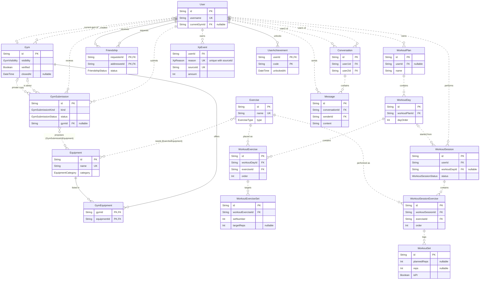

*This project has been created as part of the 42 curriculum by shank187 and the ft_transcendence team.*

# Gym App — ft_transcendence

## Description

Gym App is a five-person, full-stack social fitness platform built for the 42 `ft_transcendence` project (subject v21.1). Its validation product connects one loop:

```text
Discover a gym → plan a workout → train and log sets → review progress → earn achievements → interact with friends
```

The project deliberately freezes scope around a reliable 14-point validation target. AI/coaches, social feeds, advanced workout mutation, advanced recommendations, and other bonus work remain deferred until the core validation gate is green.

### Validation features

- Secure email/password authentication and first-login onboarding
- Own profile, avatar, OAuth, legal pages, and multi-user correctness
- Gym discovery, details, equipment, search, filtering, sorting, and pagination
- Canonical exercise catalog with muscle groups, equipment, and exercise types
- Custom workout plans, workout days, ordered exercises, and planned sets
- Empty or planned workout sessions with historical snapshots
- Type-aware set logging, workout completion, history, volume, and basic PRs
- Friends, presence, real-time chat, and message history
- XP, achievements, and leaderboard
- Responsive custom design system and Chrome/Firefox/Edge verification

Implementation status must be taken from GitHub/Trello. A feature listed in the frozen target is not automatically implemented.

## Current implementation checkpoint — 30 September 2026

Verified on `main` at `177c75a`, plus `feature/workout-plans-get` (pending merge):

- React/Vite/TypeScript frontend and Express/TypeScript backend
- PostgreSQL through Prisma
- Docker Compose development topology
- Registration, login, Google OAuth, refresh/logout/session-check infrastructure, and onboarding route
- Protected frontend layout with `/home`, `/workouts`, and placeholder `/workouts/new-plan`
- `/workouts` lists the user's own plans with loading/error/retry/empty states
- Authenticated `GET /api/workout-plans` returning owned plans only (branch `feature/workout-plans-get`)
- Authenticated, paginated exercise catalog API (catalog UI exists but is not currently routed)
- Shared `Button`, `Card`, and loading/error/empty state foundations
- Workout planning/execution schema foundation

Current Slice 3 gate: close out `GET /api/workout-plans` verification (non-empty plan, real day count, null description, cross-user isolation), then `POST /api/workout-plans` / Create Plan behind `/workouts/new-plan`. Catalog failure recovery is still required before validation but is intentionally scheduled when the catalog re-enters the picker/search flow.

## Technical stack

| Layer | Technology | Why |
|---|---|---|
| Frontend | React 19, React Router, Vite, TypeScript, Tailwind CSS | Component UI, typed client code, fast builds, responsive styling |
| Backend | Node.js, Express 5, TypeScript, Zod | Explicit HTTP API and runtime validation |
| Data | PostgreSQL, Prisma 6 | Relational integrity, migrations, typed database access |
| Infrastructure | Docker Compose, GitHub | Reproducible services and collaborative review |

The application is a modular monolith: one frontend, one Express backend, one PostgreSQL database, and domain modules inside the shared applications. It is not a microservice system.

## Instructions

### Prerequisites

- Git
- Docker Engine with Docker Compose v2
- Node 24 (only to run build/lint outside Docker; `nvm use` reads `.nvmrc`)
- A local `.env` derived from the committed non-secret example

### Setup

```bash
git clone https://github.com/shank187/ft_transcendence.git
cd ft_transcendence
make setup
```

Fill every required value with local credentials. Never commit `.env` or real secrets.

> Repository gap at this checkpoint: the safe automated environment bootstrap and complete Compose JWT injection are assigned to S1/shared infrastructure. Until that work merges, verify the effective Compose configuration before relying on `make`.

### Start

```bash
make
```

Equivalent current command:

```bash
docker compose up -d --build
```

Default development ports currently exposed:

- Frontend: `5173`
- Backend: `3000`
- PostgreSQL: `5432`
- Prisma Studio target: `5555`

Ports and public development URLs are configuration, not secrets. Passwords, tokens, private keys, and deployment credentials are secrets.

### Verification

```bash
docker compose ps
docker compose logs backend
docker compose logs frontend
```

Run narrow checks inside the relevant service or local environment:

```bash
cd frontend && npm run build && npm run lint
cd backend && npm run build && npm run prisma:validate
```

Outside Docker, `npx prisma generate` needs `DATABASE_URL`: copy `backend/.env.example` to `backend/.env` and fill it first.

## Architecture and documentation

- [`docs/architecture.md`](docs/architecture.md) — system boundaries, slices, request flow, and contracts
- [`docs/api.md`](docs/api.md) — implemented endpoints and API conventions
- [`docs/database.md`](docs/database.md) — current schema mental model and historical-data rules
- [`docs/development.md`](docs/development.md) — branch, review, verification, and environment workflow
- [`docs/SCOPE_AND_VALIDATION.md`](docs/SCOPE_AND_VALIDATION.md) — frozen product, 14-point module plan, and cutoffs
- [`docs/UPGRADE.md`](docs/UPGRADE.md) — October 2026 dependency upgrade: what changed, what to run after pulling, what is deferred

The executable sources remain authoritative for current implementation details:

- `frontend/src/App.tsx`
- `backend/src/app.ts`
- `backend/prisma/schema.prisma`
- `docker-compose.yml`
- `Makefile`

## Team information

The repository must contain the confirmed names/logins for all five members before evaluation. Do not guess them here.

| Member | Role | Slice/responsibility |
|---|---|---|
| Aymane (`shank187`) | Technical Lead / Architect; Developer | Architecture/review and S3 Workout Planning & Execution |
| TODO: confirmed login | TODO: confirmed role | S1 Platform & Identity |
| TODO: confirmed login | TODO: confirmed role | S2 Gym Discovery & Equipment |
| TODO: confirmed login | TODO: confirmed role | S4 Social & Real-Time Interaction |
| TODO: confirmed login | TODO: confirmed role | S5 Progress & Gamification |

### Project management

- Trello: scope, priorities, ownership, and integration gates
- GitHub branches and pull requests: implementation and peer review
- Discord/team meetings: decisions and blocker escalation
- Vertical slices: each owner delivers frontend → API → service → Prisma → PostgreSQL flows

## Frozen modules — 14 points

| Module | Size | Points | Primary ownership |
|---|---:|---:|---|
| Frontend + Backend Frameworks | Major | 2 | Shared |
| ORM | Minor | 1 | Shared/database |
| Standard User Management | Major | 2 | S1 + S4 |
| User Interaction | Major | 2 | S4 |
| Real-Time Features | Major | 2 | S4 + S1 infrastructure |
| Advanced Search | Minor | 1 | S2 + S3 |
| Custom Design System | Minor | 1 | Shared frontend |
| Gamification | Minor | 1 | S5 |
| OAuth 2.0 | Minor | 1 | S1 |
| Two Additional Browsers | Minor | 1 | Shared QA |
| **Total** |  | **14** |  |

Only fully working and demonstrable modules count. Detailed evidence and final contributors must be completed before evaluation.

## Database schema

The canonical schema is `backend/prisma/schema.prisma`. Key tables and relations (`|o` zero or one, `||` exactly one, `o{` zero or many):



Design decisions:

- **Plans vs history.** Starting a workout copies the plan's targets into the session (`WorkoutSet.planned*`), so editing a plan never changes past workouts.
- **One canonical `Equipment` table** shared by gyms (`GymEquipment`) and exercises (`ExerciseEquipment`), so "what can I do at my gym" is a join, not a second vocabulary.
- **One `Gym` table with states.** `visibility`, `verified`, `source` and `closedAt` describe verified, unverified, private and closed gyms. A member's `GymSubmission` changes nothing until an admin approves it in one transaction, guarded on `status = PENDING` and on the gym's `updatedAt`, so a double click or a stale suggestion returns 409.
- **Rewards are an event log.** `XpEvent` is unique on `(reason, sourceId)`, so a workout or an approval never pays twice; total XP, level and leaderboard are computed from it.
- **Delete rules.** Cascade for data a user owns, SetNull for references history must survive, Restrict for catalog rows that history uses.

Details: [docs/database.md](docs/database.md) (domains, invariants, migrations) and [docs/database-relationships.md](docs/database-relationships.md) (focused diagrams and delete rules).

## Resources and AI usage

Primary references:

- `ft_transcendence` subject v21.1
- React, React Router, Vite, Express, Prisma, PostgreSQL, Docker Compose, TypeScript, and Zod official documentation

AI was used for bounded explanations, documentation drafting, review checklists, debugging hypotheses, and planning. Generated work must be inspected, tested, understood, and peer-reviewed. AI output is not accepted as implementation evidence by itself, and each owner must be able to explain and modify their code during evaluation.

## Individual contributions

Keep this section evidence-based and update it from merged commits/PRs before evaluation. At this checkpoint, Aymane’s verified work includes the workout schema foundation, exercise-catalog vertical slice/pagination, shared UI contributions, architecture/context documentation, and Technical Lead coordination. Add every teammate’s verified merged work without inflating or transferring ownership.

## Known gaps at this checkpoint

- Workout plan create/detail/update/delete, days/exercises/sets, and all session APIs/UI are not yet implemented; only the owned-plan list read exists.
- Error response bodies are inconsistent (`{ message }` vs `{ error }`) until S1 finalizes the shared error DTO.
- Exercise search/filter and complete recovery hardening remain pending.
- Safe `.env` bootstrap, JWT Compose injection, and CI/Gitleaks remain S1/shared tasks.
- Frozen S2/S4/S5 flows and several mandatory legal/security/QA requirements remain integration work.

This list is a dated checkpoint, not a permanent project status.
