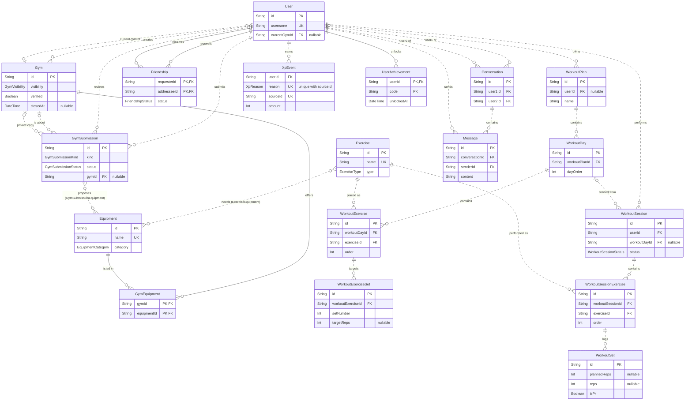

*This project has been created as part of the 42 curriculum by aelbour, abel-had, zyahansa, mouarar, sabadri.*

# Gym App — ft_transcendence

Development continues in a private repository, so the live app may include features or fixes that haven’t reached this public version yet.

## Description

Gym App is a five-person, full-stack social fitness platform built for the 42 `ft_transcendence` project (subject v21.1). It connects one loop:

```text
Discover a gym → plan a workout → train and log sets → review progress → earn achievements → interact with friends
```

The scope stays on this loop. AI coaching, social feeds and workout recommendations are out of scope.

### Key features

- Secure email/password authentication and first-login onboarding
- Own profile, avatar, OAuth, legal pages, and multi-user correctness
- Gym discovery, details, equipment, search, filtering, sorting, and pagination
- Canonical exercise catalog with muscle groups, equipment, and exercise types
- Custom workout plans, workout days, ordered exercises, and planned sets
- Empty or planned workout sessions with historical snapshots
- Type-aware set logging, workout completion with a summary, volume and basic PRs, and the last workout of each day on Home
- Friends, presence, real-time chat, and message history
- XP, achievements, and leaderboard
- Responsive custom design system, with Chrome, Firefox and Brave as browser verification targets

## Features by area

- React/Vite/TypeScript frontend, Express/TypeScript backend, PostgreSQL through Prisma, Docker Compose
- Auth: email/password with email code, Google OAuth, refresh/logout/session check, onboarding, admin navigation for the ADMIN role
- Profile: own profile, settings with metric or imperial units, avatar (image content checked with Sharp), public profile, Privacy and Terms pages
- Gyms: search, details, current gym, private gyms, gym submissions with photos, "My submissions", admin review (approve, or reject with a reason)
- Workouts (S3): plans, days, day editor, exercise picker (search, filters, sort, gym filter, pagination), active workout (add, move and remove exercises; add, edit and tick sets), finish with PRs (bodyweight sets included) and XP, weights in kg or lb and distances in km or mi, next workout on Home
- Progress: summary, leaderboard, achievements, weekly stats on Home
- Social: friends, requests, blocking, user search, conversations, WebSocket chat with presence and read receipts, connection and message size limits

The full endpoint list is in [`docs/api.md`](docs/api.md).

## Technical stack

| Layer | Technology | Why |
|---|---|---|
| Frontend | React 19, React Router, Vite, TypeScript, Tailwind CSS | Component UI, typed client code, fast builds, responsive styling |
| Backend | Node.js, Express 5, TypeScript, Zod | Explicit HTTP API and runtime validation |
| Data | PostgreSQL, Prisma 6 | Relational integrity, migrations, typed database access |
| Infrastructure | Docker Compose, GitHub | Reproducible services and collaborative review |

The application is a modular monolith: one frontend, one Express backend, one PostgreSQL database, and domain modules inside the shared applications. It is not a microservice system.

## Supported browsers

The supported browser targets are the latest stable Google Chrome, Mozilla Firefox and Brave. Browser verification is shared QA. The team reports that sabadri's manual checks passed for the flows below in all three browsers; exact browser versions and run details remain to be recorded.

## Instructions

### Prerequisites

- Git
- Docker Engine with Docker Compose v2
- Node 24 (only to run build/lint outside Docker; `nvm use` reads `.nvmrc`)
- A local `.env` derived from the committed non-secret example

### Setup

```bash
git clone https://github.com/shank187/ft_transcendence.git
cd ft_transcendence
cp .env.example .env
```

Fill every required value with local credentials. Never commit `.env` or real secrets. Compose refuses to start while a required value (database credentials, JWT secrets, SMTP, administrator credentials or public URLs) is missing. Use `SMTP_PORT=587`: the backend rejects other SMTP ports at startup. Supply working SMTP credentials so registration emails can be delivered. Compose constructs the backend's `DATABASE_URL` from `POSTGRES_USER`, `POSTGRES_PASSWORD` and `POSTGRES_DB`; a host-side Prisma command needs its own reachable database URL.

### Start

```bash
make
```

Equivalent current command:

```bash
docker compose up -d --build
```

Open the application at **https://localhost:4438**.

Default development ports currently exposed:

- Nginx HTTPS: `4438` on the host, forwarded to `443` inside the container
- PostgreSQL: `5432`
- Prisma Studio: `5555` when started with `make db-studio`

Frontend `5173` and backend `3000` are internal container ports reached through Nginx.
Set `FRONTEND_URL` and `VITE_API_URL` to `https://localhost:4438` and
`GOOGLE_REDIRECT_URI` to `https://localhost:4438/api/auth/google/callback`.
In the Google OAuth client settings, register `https://localhost:4438` as an
authorized JavaScript origin and the same callback URL as an authorized redirect URI.

Ports and public development URLs are configuration, not secrets. Passwords, tokens, private keys, and deployment credentials are secrets.

### Verification

```bash
docker compose ps
docker compose logs backend
docker compose logs frontend
```

Run these checks from the repository root with the services running:

```bash
docker compose exec frontend npm run build
docker compose exec frontend npm run lint
docker compose exec backend npm run build
docker compose exec backend npm run prisma:validate
```

For host-side checks, first copy `backend/.env.example` to `backend/.env` and fill `DATABASE_URL` with a URL reachable from the host (normally `localhost:5432` for this Compose setup). Then run from the repository root:

```bash
(cd frontend && npm ci && npm run build && npm run lint)
(cd backend && npm ci && npm run prisma:generate && npm run build && npm run prisma:validate)
```

### Browser verification — shared QA

**Tester: sabadri.** According to the team's manual-test report, the flows below passed in Chrome, Firefox and Brave. These are reported results, not automated test results. Exact browser versions, test date, tested commit, viewport sizes and evidence were not supplied with the report and remain to be recorded. Keep credentials, tokens and private messages out of test evidence. The refresh/WebSocket integration limitation documented below remains tracked separately in issue #51.

| Owner and flows | Chrome result | Firefox result | Brave result |
|---|---|---|---|
| S1: register, verify/resend email, login, Google login, reload/session restore, logout | Passed | Passed | Passed |
| S1: onboarding, profile/settings, unit changes, password, avatar upload/remove, admin access | Passed | Passed | Passed |
| S2: gym search/filters/sort/pagination, details, current gym, private gym editing, submissions | Passed | Passed | Passed |
| S3: exercise picker, plans/day editor, start/resume, set logging, units, finish/discard | Passed | Passed | Passed |
| S4: profiles, user search, friend requests, blocking, chat/history/read receipts, presence/reconnect | Passed | Passed | Passed |
| S5: progress, achievements, leaderboard, weekly stats, approve/reject submissions | Passed | Passed | Passed |
| Shared: responsive navigation, keyboard/focus, dialogs/selects, legal-page access, console/network errors | Passed | Passed | Passed |

For live features, use two different accounts and check both sides. Include a page reload, a temporary disconnect/reconnect, and more than five chat tabs to check the replaced-connection notice. For settings, save Imperial values, reload, and verify displayed units and stored kg/cm. Browser-specific limitations must describe an observed issue and its affected flow; write "none found" only after the corresponding checks.

For each completed browser run, add a record using this template and update the corresponding cells in the checklist:

```text
Tester: sabadri
Date: <YYYY-MM-DD>
Commit: <tested commit hash>
Browser and version: <Chrome / Firefox / Brave and exact version>
Viewport: <width x height; desktop or mobile>
Flows checked: <specific features from the checklist>
Result: <PASS / FAIL / PARTIAL>
Observed issues or limitations: <reproduction steps and issue link, or none found>
Evidence: <test notes or screenshot reference, if available>
```

Use PASS only for flows actually checked successfully; use PARTIAL when some listed flows were not checked, and FAIL when an observed result differs from the expected behavior. Keep unchecked cells as `Not recorded`. Each slice owner supplies their results and the PM consolidates the shared record. After a fix, retest the affected flow and record the new commit/result. Complete the Chrome baseline and both additional browsers before claiming the browser module as verified.

## Architecture and documentation

- [`docs/architecture.md`](docs/architecture.md) — system boundaries, slices, request flow, and contracts
- [`docs/api.md`](docs/api.md) — implemented endpoints and API conventions
- [`docs/contracts.md`](docs/contracts.md) — what S2, S3 and S5 rely on from each other
- [`docs/database-relationships.md`](docs/database-relationships.md) — focused schema diagrams and delete rules
- [`docs/database.md`](docs/database.md) — current schema mental model and historical-data rules
- [`docs/SCOPE_AND_VALIDATION.md`](docs/SCOPE_AND_VALIDATION.md) — product scope, 14-point module plan, and team cutoffs

The executable sources remain authoritative for current implementation details:

- `frontend/src/App.tsx`
- `backend/src/app.ts`
- `backend/prisma/schema.prisma`
- `docker-compose.yml`
- `Makefile`

## Team information

| Member | Login | Role | Slice/responsibility |
|---|---|---|---|
| Aymane El Bour | `aelbour` | Technical Lead / Architect; Developer | Architecture/review and S3 Workout Planning & Execution |
| Abdelhamid El Haddadi | `abel-had` | Project Manager; Developer | S1 Platform & Identity |
| Salaheddine Badri | `sabadri` | Product Owner; Developer | S5 Progress & Gamification |
| Zyad Ahansal | `zyahansa` | Developer | S2 Gym Discovery & Equipment |
| Mohamed Ouarar | `mouarar` | Developer | S4 Social & Real-Time Interaction |

### Project management

- Trello until 13 October 2026, then [`docs/SCOPE_AND_VALIDATION.md`](docs/SCOPE_AND_VALIDATION.md): scope, priorities, ownership, and integration gates
- GitHub branches and pull requests: implementation and peer review
- Discord/team meetings: decisions and blocker escalation
- Vertical slices: each owner delivers frontend → API → service → Prisma → PostgreSQL flows

## Features List

- **Accounts and sessions (`abel-had`, S1).** Email/password registration, verification and resend, login, session restoration after reload, access-token refresh and logout. Passwords and verification codes are hashed; refresh-token hashes are stored in per-login sessions.
- **Google login (`abel-had`, S1).** Google authorization and callback verification, existing-account linking or account creation, application session creation, and onboarding/home redirects.
- **Onboarding and settings (`abel-had`, S1).** Display name, biography, experience, goal and unit preferences; weight and height conversion for Imperial display with kg/cm storage; password change and validated avatar upload/removal with a default avatar.
- **Application shell and administration (`abel-had`, S1).** Guest/authenticated/admin route guards, administrator promotion, desktop/mobile navigation, Home layout, landing page, Privacy/Terms pages, Docker setup and Nginx HTTPS/WebSocket forwarding. Public profile/social actions are shared with S4; gym moderation is S2 + S5.
- **Gym discovery and personal gyms (`zyahansa`, S2).** Search with city/verified filters, sorting and pagination, gym details/equipment, current gym selection, and private gym creation/editing. Seed scripts import Google Places data and team-verified gym data.
- **Gym submissions (`zyahansa`, S2; moderation by `sabadri`, S5; image validation by `abel-had`, S1).** Members submit a public gym with equipment/photos and follow its review status. Administrators approve publication or reject with a reason.
- **Progress and rewards (`sabadri`, S5, integrated with S3).** Saved XP, levels, achievements, a friends-only leaderboard including the current user, profile progress components and weekly activity statistics on Home.
- **User Interaction (`mouarar`, S4).** Users can search for and view public profiles, send and respond to friend requests, view and remove friends, and block or unblock users. Friends can exchange direct messages and load previous messages from their conversation history.
- **Real-Time Features (`mouarar`, S4, with S1 infrastructure).** The React app connects to the Node backend over WebSocket for live messages, read receipts, online presence, and friendship updates. The backend authenticates each socket and sends events to the affected users' connected sessions. HTTP endpoints load saved conversations and message history. Nginx handles HTTPS and forwards the WebSocket upgrade.
- **Workout plans and days (`aelbour`, S3).** Users create, rename and delete up to 3 plans, each with up to 7 named days.
- **Day editor (`aelbour`, S3).** Users pick up to 20 exercises for a day, order them, and give each up to 20 sets with targets that match the exercise type (weight and reps, reps, time or distance). Save sends the whole day at once.
- **Exercise search (`aelbour`, S3).** The 318-exercise catalog can be searched by name, filtered by muscle, equipment and "available at my gym", sorted A–Z or Z–A, and paged.
- **Active workout (`aelbour`, S3).** Users start an empty workout or a plan day (the day's targets are copied into the workout), then add, move and remove exercises, add and delete sets, enter values and tick sets. A ticked set that beats the exercise's earlier best shows a PR badge. One workout can be in progress per user.
- **Finish and summary (`aelbour`, S3; XP by `sabadri`, S5).** Finishing needs one ticked set. The summary shows time, sets, volume, exercises and PRs, and XP is given once even if Finish is sent twice.
- **Units (`aelbour`, S3).** Weight in kg or lb and distance in km or mi, from the user's setting. The database always stores kg and meters.
- **Next workout on Home (`aelbour`, S3).** Home shows the next day of the user's plan with Start, Resume or Add exercises, the last time that day was done, and the target to beat.

## Modules — 14 points

| Module | Size | Points | Primary ownership |
|---|---:|---:|---|
| Frontend + Backend Frameworks | Major | 2 | Shared |
| ORM | Minor | 1 | Shared/database |
| Standard User Management | Major | 2 | S1 + S4 |
| User Interaction | Major | 2 | S4 |
| Real-Time Features | Major | 2 | S4 + S1 infrastructure |
| Advanced Search | Minor | 1 | S2 + S3 |
| Custom Design System | Minor | 1 | Shared frontend |
| Gamification | Minor | 1 | S5 |
| OAuth 2.0 | Minor | 1 | S1 |
| Two Additional Browsers | Minor | 1 | Shared QA |
| **Total** |  | **14** |  |

### How the modules are implemented

- **Frontend + Backend Frameworks (Major, shared; stack chosen by aelbour as Tech Lead).** React 19 with React Router and Vite on the frontend, Express 5 on the backend, both in TypeScript. The team already knew JavaScript, both have official docs we could rely on, and one language on both sides lets the backend and frontend share types (`shared/*.d.ts`). Domain routes use controllers and services where needed, with Zod, express-validator or explicit runtime checks validating inputs. Each slice owner implemented their frontend/backend flows.
- **ORM (Minor, shared; schema lane by aelbour).** Prisma 6 with PostgreSQL was chosen for typed queries, relational constraints and versioned migrations. `backend/prisma/schema.prisma` is the single schema, and every change goes through a committed migration that `prisma migrate deploy` applies at startup. Prisma transactions keep multi-row writes whole: finishing a workout, saving a day and approving a gym each run in one transaction, and the places where two requests can collide take a row lock (`FOR UPDATE`) or run as `Serializable`. Each slice owner contributes their domain queries.
- **Advanced Search (Minor; exercises by aelbour, gyms by zyahansa).** Exercises: `GET /api/exercises` takes `search`, `muscle`, `equipment` and `gym=true` (only exercises the current gym's equipment allows), all combinable, `sort=name_asc|name_desc`, and `page`/`limit` (12 by default, 50 at most); it returns `total` and `totalPages`. Zod rejects a bad page, limit or sort with a 400. The exercise picker in the day editor and the active workout uses it. Gyms: `GET /api/gyms/search` takes a name search, city and verified filters, a sort by name or newest, and pages of 6.

Search was chosen so users can narrow a large catalog to relevant exercises and gyms instead of scrolling through every entry. The remaining core modules are described below.

#### Standard User Management — Major, 2 points

- **Why:** accounts connect each user's profile, gyms, workouts, progress and friendships across visits and browsers.
- **Implementation:** registration validates email/username/password, checks uniqueness, hashes the password and email code with bcrypt, and saves a `PendingRegistration` with an expiration and attempt limit. Verification creates the user and USER role, then signs a 15-minute access JWT and creates a seven-day refresh session. The browser receives the raw refresh token in an HttpOnly cookie; `Session.tokenHash` stores its SHA-256 hash. Refresh looks up the session and checks expiration/revocation; logout revokes it and clears the cookie. Expired sessions are deleted when a new session is created.
- **User-facing features:** onboarding, profile/settings, password change, default avatar and avatar upload/removal. Multer limits upload size and type; Sharp checks the image content and decodes it. Authentication middleware verifies access JWTs before protected actions. Public profiles, friendships and online status complete the social side of user management.
- **Who:** abel-had implements authentication, sessions, onboarding, own profile/settings, avatars and route protection; mouarar implements friendships, public-profile interaction and presence, with progress components from sabadri.
- **Sources:** `backend/src/modules/auth/`, `backend/src/modules/users/`, `backend/src/middleware/upload_avatar.ts`, `frontend/src/features/auth/` and the profile/social features.

#### OAuth 2.0 — Minor, 1 point

- **Why:** users can authenticate with their Google account without choosing an application password.
- **Implementation:** the backend generates an authorization URL with `openid` and `email` scopes and a random state saved in a short-lived HttpOnly, SameSite=Lax cookie. The callback compares state, exchanges the authorization code using `google-auth-library`, verifies the ID token against the configured client ID, and requires a verified email. It finds the application user by email, creates one or links their Google identifier, assigns the USER role and creates the same refresh session used by password login. The browser is redirected to onboarding or Home; `AuthProvider` obtains the application's access token through session restoration.
- **Configuration:** `GOOGLE_REDIRECT_URI` must match a registered redirect URI, including scheme, host, port and callback path. `FRONTEND_URL` selects the final application redirect. Google tokens are used for Google identity verification; application API requests use the application's own access JWT.
- **Who:** abel-had, including the callback, frontend login entry points and HTTPS redirect configuration.
- **Sources:** `backend/src/modules/auth/google.controller.ts`, `frontend/src/features/auth/AuthContext.tsx` and the login/register pages.

#### User Interaction — Major, 2 points

- **Why:** friends can find each other, share public profiles and communicate around their training.
- **Implementation:** authenticated users search for profiles, send/accept/decline friend requests, remove friends and block/unblock users. PostgreSQL stores friendship state, conversations and messages. HTTP endpoints load conversations and cursor-paginated history, up to 20 messages per page. The backend checks accepted friendship before sending messages or updating read receipts. Live delivery uses the Real-Time module below.
- **Who:** mouarar implements user search, social profile actions, friendships, blocking, chat/history and read receipts; public profile presentation integrates S1 account data and S5 progress components.
- **Sources:** `backend/src/modules/friends/`, `backend/src/modules/chat/` and `frontend/src/features/profile/` / `frontend/src/features/chat/`.

#### Real-Time Features — Major, 2 points

- **Why:** chat, read receipts, presence and friendship changes should reach other connected users without a page reload.
- **Implementation:** `ws` shares the backend HTTP server at `/chat`, forwarded through Nginx as WSS. The first client frame authenticates with an application access JWT; the server closes unauthenticated connections after five seconds. Authenticated sockets are grouped by user so events reach their connected tabs. Presence follows the user's connected sockets, and a new connection receives an online-friends snapshot. A ping/pong heartbeat every 30 seconds detects unresponsive connections.
- **Disconnect/reconnect:** the frontend marks the socket disconnected, clears stale online IDs and retries ordinary closures after three seconds. Its effect restarts when the AuthContext access token changes. The server allows five sockets per user and closes the oldest with code 4001 when replaced; that tab shows a manual reconnect action instead of immediately replacing another tab.
- **Refresh synchronization:** Axios notifies AuthContext when an API token is refreshed. Updating the context restarts the WebSocket effect with the new token. Reconnection after token expiry without an intervening API refresh still needs a separate end-to-end check; follow-up remains tracked in [issue #51](https://github.com/shank187/ft_transcendence/issues/51).
- **Who:** mouarar implements the WebSocket protocol, presence, events and reconnect UI; abel-had supplies authentication integration and Nginx HTTPS/upgrade forwarding.
- **Sources:** `backend/src/modules/chat/chat.logic.ts`, `frontend/src/layouts/WebSocketProvider.tsx`, `frontend/src/layouts/MainLayout.tsx` and `nginx/default.conf`.

#### Custom Design System — Minor, 1 point

- **Why:** shared visual rules and components keep account, gym, workout, social and progress screens consistent as different members build them.
- **Palette:** Tailwind theme tokens in `frontend/src/styles/globals.css` define canvas `#050505`, surface `#222222`, raised surface `#262626`, border `#3a3a3a`, primary lime `#CCFF00`, main text `#f5f5f5`, secondary text `#bdbdbd` and danger `#f87171`. Set-type colors distinguish heavy, warm-up, drop and failure sets.
- **Typography and icons:** system sans-serif text and an Oswald display-font token, reusable Tailwind size/weight classes, shared corner radii and a visible keyboard-focus outline. `lucide-react` supplies navigation and action icons. Responsive layouts adapt the sidebar to mobile navigation.
- **Reusable components:** these 13 components are used by application pages/features; class helpers are not counted as components.

| Component | Purpose / example use |
|---|---|
| `Button` | Shared action variants and sizes across forms and workouts |
| `Card` | Surface container, including Home cards |
| `Form_input` | Labeled inputs in registration, onboarding and settings |
| `Form_select` | Labeled selects in onboarding/settings and admin review |
| `FilterSelect` | Exercise-picker filters |
| `Dialog` | Workout confirmations, exercise picker and admin review |
| `DropdownMenu` | Plan/day and workout action menus |
| `Or_divider` | Email/Google authentication separator |
| `ProgressTabs` | Progress/Achievements navigation |
| `LoadingState` | Progress and feature loading feedback |
| `ErrorState` | Progress and feature error feedback |
| `EmptyState` | Empty catalogs, exercise picker and workout state |
| `NotFoundState` | Missing plans, workouts and unknown pages |

- **Who:** aelbour establishes theme tokens, core UI components and workout/picker extensions; abel-had contributes shared account forms, shell/landing styling and the lime branding update; sabadri contributes the shared progress tabs and progress integration. zyahansa and mouarar integrate the UI into gym and social screens. Component/theme commit history records the individual changes.
- **Sources:** `frontend/src/components/ui/`, `frontend/src/components/states/` and `frontend/src/styles/globals.css`.

#### Gamification — Minor, 1 point

- **Why:** saved rewards and visible progress give feedback for completed training. This module covers XP/levels, achievements and the leaderboard; weekly activity analytics is a separate bonus claim.
- **Rules:** a completed workout awards 100 XP, each PR award gives 50 XP, and `level = floor(totalXp / 500) + 1`. Milestones unlock at 1, 10, 50 and 100 completed workouts. Early Bird uses completion times from 05:00 to before 09:00 UTC; Night Owl uses 22:00 to before 05:00 UTC. Full PR and reward rules are in [contracts.md](docs/contracts.md).
- **Persistence:** S3 calls S5's `award()` inside the workout-finish transaction. `XpEvent` is unique on `(reason, sourceId)` and duplicate events are skipped, so a repeated Finish cannot pay twice. `UserAchievement` stores unlocks; the summary and friends-only leaderboard read PostgreSQL, include the current user and survive reload/login. Gym approval gives no XP.
- **Visual feedback:** the Progress page shows level progress, earned/locked achievement badges and leaderboard ranking; profile cards show XP and achievement progress. The finish API returns XP gained, level-up state and newly unlocked codes for workout feedback.
- **Who:** sabadri implements reward rules, progress APIs/UI, achievements and leaderboard; aelbour integrates the award call with workout completion; abel-had supplies the Home layout containing the weekly card.
- **Sources:** `backend/src/modules/progress/`, `frontend/src/features/progress/`, `frontend/src/features/profile/` and `backend/src/modules/workout-sessions/`.

#### Two Additional Browsers — Minor, 1 point

- **Why:** the application should remain usable beyond the mandatory Chrome baseline.
- **Implementation and verification:** the React/Tailwind frontend uses shared controls and responsive layouts, with Firefox and Brave as the two additional verification targets. Each owner must check all their features, fix incompatibilities and record observed limitations in the browser table above. Browser compatibility cannot be established by a TypeScript build or source inspection alone.
- **Who:** Shared QA across all five members; sabadri is the reported tester for the passing manual checks above. The PM collects browser versions, run details and outstanding issues; those supporting details remain to be recorded.

### Bonus modules — beyond the 14

Counted once the 14 points above are validated (subject chapter VII, 5 bonus points at most).

| Module | Size | Points | Ownership |
|---|---:|---:|---|
| User activity analytics and insights dashboard | Minor | 1 | S5 + S3 (Home) |
| Module of choice: community gym database with moderation | Minor | 1 | S2 + S5 |
| **Total with bonus** |  | **16** |  |

#### User activity analytics and insights dashboard (Minor, 1 pt)

- **Why:** a training app is useful when the user sees what they did and what to do next. Home is the first screen after login, so the analytics live there.
- **Activity analytics:** `GET /api/progress/week` counts the user's completed workouts for the current week (Monday–Sunday, UTC): workouts, sets, volume in kg and PRs. `getWorkoutStats(userId, from, to)` in `backend/src/modules/workout-sessions/workout-stats.ts` reads only the authenticated user's completed sessions.
- **Insight — what to do next:** `GET /api/workout-plans/nextday` works out the next workout from the user's history: the day after the last completed day of that plan, back to day 1 after the last one, or the first day of the newest plan if nothing is done yet. If that workout is already in progress, Home resumes it; if the day has no exercises yet, Home opens its editor instead of starting an empty workout.
- **Insight — what to beat:** the same response carries `lastTime`, the user's last finished workout of that day (when, volume, sets, time, from the same `toSummaryDto` as the workout summary). Home turns it into a target ("Beat 2,705 kg of volume today", or the sets for a day without weights), says "First time on this day" when there is no history, and links to that past workout.
- **Kept apart from Gamification:** XP, levels, achievements and the leaderboard belong to the Gamification module and are not part of this claim.
- **Who:** sabadri (weekly stats endpoint and card), aelbour (next workout endpoint and card with the "last time" target), abel-had (Home layout), mouarar (online friends on Home).

#### Module of choice: community gym database with moderation (Minor, 1 pt)

- **Why we chose it:** gyms seeded from Google Places miss places and go out of date. Members fill the gaps, and an admin keeps the public catalog trustworthy.
- **Technical challenges:**
  - One `Gym` table holds imported, team and member gyms, public or private (`visibility`, `verified`, `source`), so search, details and current gym work the same way for all of them.
  - Members can add a private gym with its equipment and use it as their current gym straight away; it stays visible only to them.
  - A submission changes nothing until an admin approves it. Approval creates the public verified gym, copies its equipment and first photo, and closes the submission in one serializable transaction, so a half-approved gym can't exist.
  - Two admins reviewing at once, or a double click: the update is guarded on `status = PENDING`, so the second review gets 409 instead of a duplicate gym. An admin can't review their own submission.
  - Rejection requires a reason (already listed, not a gym, can't confirm, other) and an optional detail the submitter can read.
  - Abuse limits: at most 5 private gyms and 5 pending submissions per user; uploaded photos are checked by type and content.
- **Value:** users can train at a gym the catalog didn't have, and the public catalog grows without losing trust.
- **Why a Minor:** it is a full workflow (submit → review → publish) with roles, transactions and concurrency handling, beyond plain CRUD, but smaller than a Major module.
- **Who:** zyahansa (private gyms, submissions with photos and equipment), sabadri (admin review queue, approve, reject with a reason).

## Database schema

The canonical schema is `backend/prisma/schema.prisma`. Key tables and relations (`|o` zero or one, `||` exactly one, `o{` zero or many):



Design decisions:

- **Plans vs history.** Starting a workout copies the plan's targets into the session (`WorkoutSet.planned*`), so editing a plan never changes past workouts.
- **One canonical `Equipment` table** shared by gyms (`GymEquipment`) and exercises (`ExerciseEquipment`), so "what can I do at my gym" is a join, not a second vocabulary.
- **One `Gym` table with states.** `visibility`, `verified`, `source` and `closedAt` describe verified, unverified, private and closed gyms. A member's `GymSubmission` changes nothing until an admin approves it in one serializable transaction, guarded on `status = PENDING`, so a double click or a second admin gets 409.
- **Rewards are an event log.** `XpEvent` is unique on `(reason, sourceId)`, so the same completed workout or personal record cannot award XP twice; total XP, level and leaderboard are computed from it.
- **Delete rules.** Cascade for data a user owns, SetNull for references history must survive, Restrict for catalog rows that history uses.

Details: [docs/database.md](docs/database.md) (domains, invariants, migrations) and [docs/database-relationships.md](docs/database-relationships.md) (focused diagrams and delete rules).

## Resources and AI usage

Primary references:

- `ft_transcendence` subject v21.1
- React, React Router, Vite, Express, Prisma, PostgreSQL, Docker Compose, TypeScript, and Zod official documentation

AI was used for bounded explanations, documentation drafting, review checklists, debugging hypotheses, and planning. Generated work must be inspected, tested, understood, and peer-reviewed. AI output is not accepted as implementation evidence by itself, and each owner must be able to explain and modify their code during evaluation.

By slice:

- **S3 and Tech Lead work (aelbour):** AI assistants (Claude and Codex) explained Prisma, Zod and React patterns, reviewed S3 and teammates' pull requests against `docs/contracts.md`, drafted the S3 sections of `docs/api.md` and this README, and wrote parts of the S3 code. Each AI-written piece of S3 code is listed with its file and commit in a personal log, so it can be re-read, tested and explained before the evaluation.
- **S1 and Project Manager work (abel-had):** Codex helped explain authentication/session flows, Google OAuth, upload validation, Docker/Nginx and frontend styling; and reviewed/drafted README and API documentation. This README's module explanations were checked against the current repository. Browser-test results and other members' personal AI usage cannot be inferred from those code/documentation reviews.

## Individual contributions

Taken from the merged commits and pull requests on `main`.

- **aelbour (S3, Technical Lead):** workout schema, exercise catalog and search, plans, days, day editor, active workout, finish with PRs (bodyweight sets included) and the S5 award call, metric and imperial units, the next workout card on Home with the last time and target to beat, the contracts between S2, S3 and S5, and reviews. Details in [`docs/readme-parts/s3-workouts.md`](docs/readme-parts/s3-workouts.md).
  Challenges:
  - *Plans vs history.* Editing a plan must not change past workouts. Starting a workout copies the day's targets into the session (`WorkoutSet.planned*`), so a workout keeps what was planned that day.
  - *Two requests at once.* A double click on Start could create two workouts, and a set ticked while Finish runs could be missed. Start runs as a `Serializable` transaction (the second start gets 409), and Finish and every set write first lock the workout row (`FOR UPDATE`), so they run one after the other.
  - *XP only once.* Finish calls S5's `award()` inside the same transaction, and `XpEvent` is unique on `(reason, sourceId)`, so a repeated Finish returns the summary without new XP.
- **abel-had (S1, Project Manager):** register, login and email verification, Google OAuth, refresh tokens and sessions, route guards, onboarding, own profile with avatar and password change, admin role, Privacy Policy and Terms of Service, backend input validation, HTTPS Nginx proxy and Docker setup.
  - **Implementation challenge — restoring a session after reload.** A short-lived access token held in frontend memory disappears on reload. `AuthProvider` checks the refresh session, requests a new access token and loads `/api/users/me`. Axios shares one pending refresh request between failed API calls and retries each original request at most once. The backend checks the stored session hash, expiration and revocation; logout revokes that session.
  - **Implementation challenge — validating actual image content.** A client can label non-image content as JPEG/PNG. Multer applies the upload size/type limits, then Sharp reads the actual format and decodes the file. Invalid uploads are deleted before the request proceeds. The image-validation callback is reused for gym images.
  - **Integration and coordination:** maintains account flows and shared navigation, integrates Home cards from other slices, configures local HTTPS and OAuth redirect URLs, and coordinates PR review and the shared browser-verification record. API token refresh now updates AuthContext so WebSocket connections can use the refreshed token.
- **zyahansa (S2):** gym search with filters and pagination, gym details, current gym, Google Places import and team-verified gym seeding, gym submissions with photos and equipment, landing page components.
  - **Implementation challenge — importing external gym data without losing existing seeds.** `fetchFromGoogleMaps.ts` requests selected Google Places fields, maps optional values into the application's seed format and saves the JSON only after a successful non-empty fetch. If a request fails or times out, the previous seed file is kept. Separate seed scripts distinguish imported data from team-verified gyms.
  - **Implementation challenge — editing gym equipment safely.** Deleting equipment before a failed update could lose the user's previous selection. The private-gym edit controller validates inputs and performs the update/equipment replacement in the same Prisma transaction. Submission records remain separate from published gyms until S5's approval workflow publishes them.
  - **Sources:** `backend/prisma/seed-data/`, `backend/src/modules/gyms/` and the gym frontend features.
- **mouarar (S4):** Helped implement public profiles. Implemented friend requests, the friends list, friend removal and blocking, direct chat, conversation history, read receipts, and online presence. Contributed to the social features on the Home page. Handled multiple tabs by limiting each user to five chat connections and letting a replaced tab reconnect manually.
  - **Implementation challenge — presence across multiple tabs.** One user can have several authenticated sockets. The backend stores a set of sockets per user, announces offline only after the last one closes, and replaces the oldest connection above the five-tab limit. The replaced tab offers manual reconnection to avoid competing automatic reconnects.
  - **Connection lifecycle:** JWT authentication must arrive within five seconds; ping/pong checks remove unresponsive sockets. Ordinary disconnections trigger a three-second client retry and an online-friends snapshot after authentication. The Real-Time module records the API-refresh synchronization and the remaining token-expiry reconnection scenario to verify end to end.
- **sabadri (S5, Product Owner):** progress summary, XP and levels, achievements, leaderboard, Progress page, and the admin approval of gym submissions.
  - **Gamification:** authenticated summary and leaderboard APIs, level progress, persistent achievement badges, profile progress components and a top-ranked friend card. The leaderboard includes the signed-in user even without accepted friends. The module section above documents the progression rules and visual feedback.
  - **Shared bonus contributions:** weekly stats API/Home card with S3 (completed workouts, sets, volume and PRs for the Monday–Sunday UTC week); admin review of S2 gym submissions, including approve/publish and reject with a reason. Admins cannot review their own submissions.
  - **Implementation challenge — awarding XP once.** Workout completion and rewards run in the same database transaction. Each XP event is unique by reward reason and source ID, so retrying Finish cannot award the same XP twice. Achievement unlocks are saved with the reward and survive refresh and login.
  - **Implementation challenge — concurrent reviews.** Approval publishes the gym and marks the submission approved in one serializable transaction. The decision checks that the submission is still pending, so a competing review cannot publish a duplicate gym.
  - **Shared UI and QA:** extracted `ProgressTabs` into reusable UI; contributes browser checks for S5 flows. The additional-browser module is Shared QA across the team, not solely S5.
