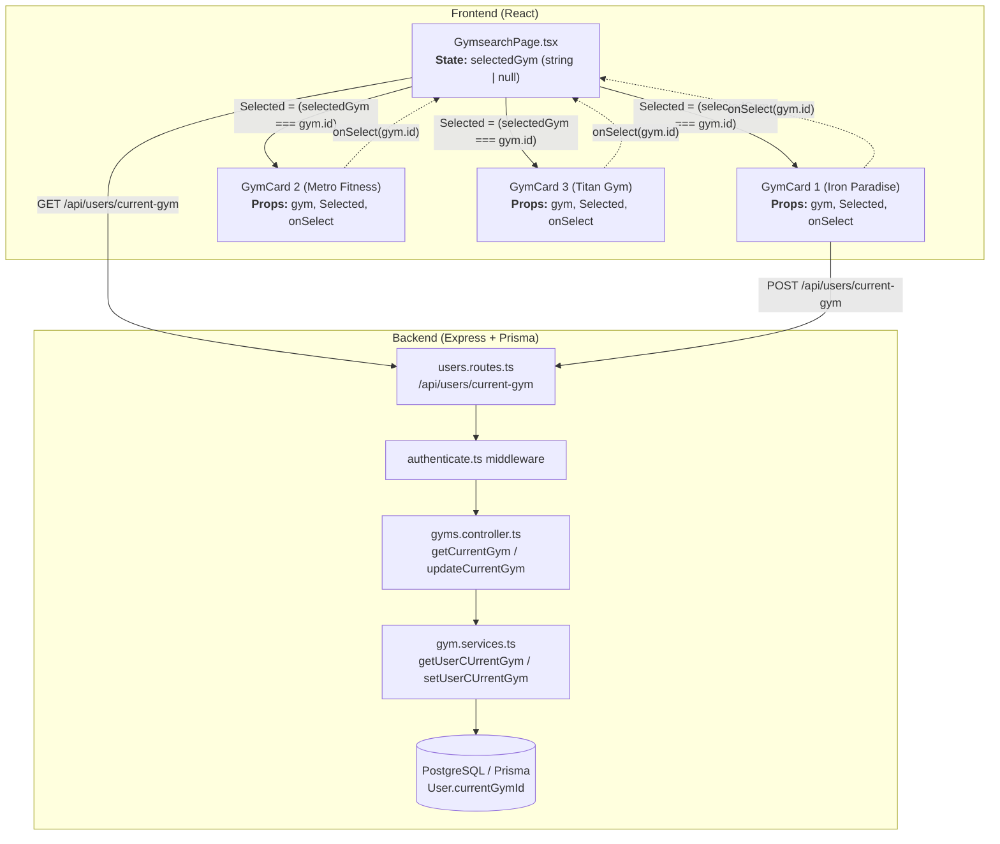
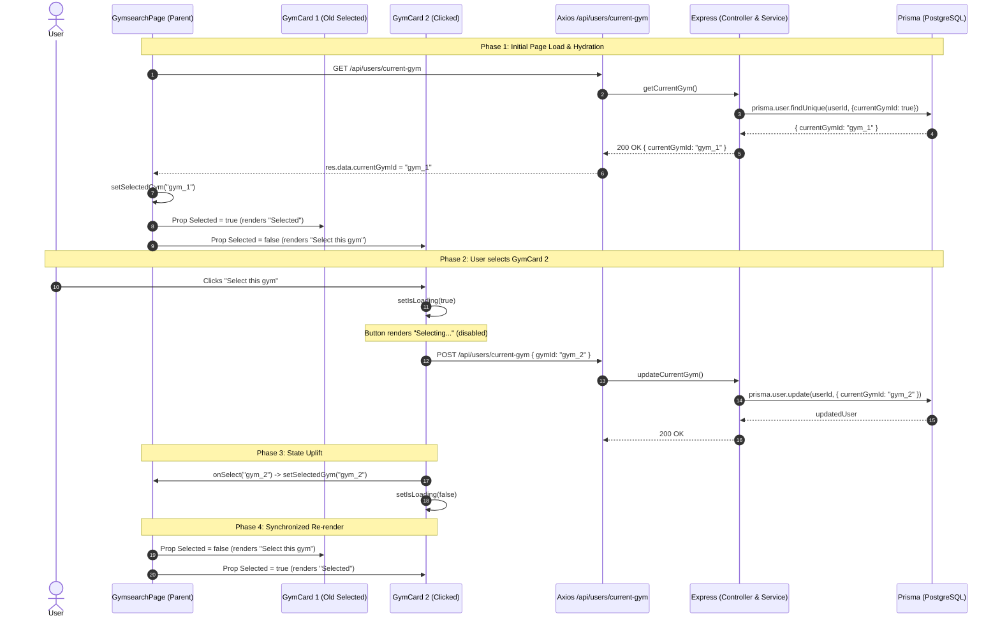

# Gym Selection Feature: End-to-End Architecture & Lifecycle

This document provides a comprehensive technical walkthrough of the **Gym Selection Feature** in `ft_trens`, covering the frontend React component tree, prop drilling & state lifting, re-render cycles at each micro-step, the HTTP/Axios network layer, and backend Express/Prisma database persistence.

---

## 1. Architectural Overview & Component Hierarchy

The feature is built around the fundamental React pattern: **"Lifting State Up"**.

Instead of each `GymCard` managing its own selection state in isolation (which would allow multiple cards to erroneously show as selected simultaneously), the **Parent Component (`GymsearchPage`)** acts as the **Single Source of Truth**.



---

## 2. Props & State Contract

### A. The Child Component: `GymCard.tsx`
`GymCard` is primarily a **controlled presentational component** regarding selection.

```typescript
interface GymCardPara {
    gym: Gym;                   // The gym data (id, name, city, image, etc.)
    Selected: boolean;          // Boolean computed by the parent
    onSelect: (id: string) => void; // Callback function to inform parent of selection
}
```

#### Internal State in `GymCard`:
- `isLoading`: `boolean` (Default: `false`)
  - Tracks whether the HTTP `POST` request for *this specific card* is currently in-flight.

---

### B. The Parent Component: `GymsearchPage.tsx`
`GymsearchPage` holds the global view state:
- `selectedGym`: `string | null` (Default: `null`)
  - Holds the UUID of the currently selected gym.

When mapping through the gym list:
```tsx
{GymList.map((gym) => (
    <GymCard 
        key={gym.id} 
        gym={gym} 
        Selected={selectedGym === gym.id}  // <-- Boolean evaluation passed as prop
        onSelect={setSelectedGym}           // <-- State setter function passed as callback
    />
))}
```

---

## 3. End-to-End Step-by-Step Execution & Re-render Cycles

### Phase 0: Initial Mount (Page Load)

```
[ User navigates to /gyms ]
       │
       ▼
GymsearchPage initializes state:
  selectedGym = null
       │
       ▼
First Render of GymsearchPage:
  GymCard 1: Selected = (null === "gym_1") -> false
  GymCard 2: Selected = (null === "gym_2") -> false
  (All buttons render: "Select this gym" in green #46d81d)
```

- **Re-render count:** 1 (Initial mount).
- **UI State:** Every gym button shows `"Select this gym"`.

---

### Phase 1: Fetching User's Saved Gym (Hydration)

Immediately after mounting, `GymsearchPage` executes its `useEffect`:

```typescript
useEffect(function() {
    async function loadCurrentGym() {
        try {
            const res = await api.get("/api/users/current-gym");
            if (res.data?.currentGymId) {
                setSelectedGym(res.data?.currentGymId);
            }
        } catch(e) {
            console.log("Failed to fetch current gym:");
        }
    }
    loadCurrentGym();
}, []);
```

#### What happens on the Backend:
1. `GET /api/users/current-gym` reaches `users.routes.ts`.
2. `authenticate` middleware decodes the session/JWT cookie and sets `req.userId`.
3. `getCurrentGym` in `gyms.controller.ts` calls `getUserCUrrentGym(req.userId)`.
4. In `gym.services.ts`:
   ```typescript
   const user = await prisma.user.findUnique({
       where: { id: userId },
       select: { currentGymId: true }
   });
   return user; // { currentGymId: "gym_1" }
   ```
5. Controller checks `if (user && user?.currentGymId)` and returns:
   ```json
   HTTP 200 OK
   { "currentGymId": "gym_1" }
   ```

#### Re-render 2 (Parent State Update):
1. `res.data?.currentGymId` is `"gym_1"`.
2. `setSelectedGym("gym_1")` is called.
3. **`GymsearchPage` re-renders:**
   - **`GymCard 1` receives:** `Selected = ("gym_1" === "gym_1")` $\rightarrow$ **`true`**
   - **`GymCard 2` receives:** `Selected = ("gym_1" === "gym_2")` $\rightarrow$ **`false`**
4. **DOM Updates:**
   - `GymCard 1` button turns **gray (`bg-gray-600`)**, text changes to **`"Selected"`**, and button is **disabled**.
   - `GymCard 2` remains green.

---

### Phase 2: User Clicks "Select this gym" on Another Card (e.g., GymCard 2)

```
[ User clicks button on GymCard 2 ]
       │
       ▼
GymCard 2 triggers handleSelectGym()
       │
       ▼
setIsloadng(true) is called inside GymCard 2
```

#### Re-render 3 (Local to GymCard 2):
- Only `GymCard 2` re-renders because its local state `isLoading` changed from `false` to `true`.
- Button on `GymCard 2` displays: **`"Selecting..."`** and disables further clicks.
- Other cards do not re-render.

---

### Phase 3: Network Request & Database Write

While `GymCard 2` is displaying `"Selecting..."`:

```typescript
// Inside GymCard.tsx:
await api.post("/api/users/current-gym", { gymId: gym.id });
```

#### Backend Pipeline:
1. `POST /api/users/current-gym` with body `{ gymId: "gym_2" }`.
2. `updateCurrentGym` controller extracts `userId` and `req.body.gymId`.
3. In `gym.services.ts`:
   ```typescript
   await prisma.user.update({
       where: { id: userID },
       data: { currentGymId: "gym_2" }
   });
   ```
4. PostgreSQL writes the foreign key link `User.currentGymId = 'gym_2'`.
5. Backend responds with `200 OK`.

---

### Phase 4: State Uplift & Full List Synchronization

Once the `await api.post` resolves successfully:

```typescript
// Inside GymCard.tsx:
onSelect(gym.id); // <--- Invokes setSelectedGym("gym_2") in parent!
```

And in the `finally` block:
```typescript
setIsloadng(false);
```

#### Re-render 4 (The Complete List Re-renders):
Because `setSelectedGym("gym_2")` updated the parent's `selectedGym` state:
1. `GymsearchPage` re-renders and re-evaluates all children:
   - **`GymCard 1` receives prop:** `Selected = ("gym_2" === "gym_1")` $\rightarrow$ **`false`**
     - Button reverts from "Selected" $\rightarrow$ **`"Select this gym"`** (green `#46d81d`, re-enabled).
   - **`GymCard 2` receives prop:** `Selected = ("gym_2" === "gym_2")` $\rightarrow$ **`true`**
     - `isLoading` resets to `false`.
     - Button switches from "Selecting..." $\rightarrow$ **`"Selected"`** (gray `#475569`, disabled).
2. The UI is now completely synchronized with the database!

---

## 4. Complete Sequence Diagram



---

## 5. Summary of Key Files

| Layer | File Path | Role |
| :--- | :--- | :--- |
| **Parent UI** | [`frontend/src/features/Gyms/components/GymsearchPage.tsx`](file:///Users/zahansal/Desktop/ft_trens/frontend/src/features/Gyms/components/GymsearchPage.tsx) | Owns `selectedGym` state, fetches saved gym on mount, distributes `Selected` prop. |
| **Child UI** | [`frontend/src/features/Gyms/components/GymCard.tsx`](file:///Users/zahansal/Desktop/ft_trens/frontend/src/features/Gyms/components/GymCard.tsx) | Renders button styling based on `Selected` prop and triggers `handleSelectGym`. |
| **Routes** | [`backend/src/modules/users/users.routes.ts`](file:///Users/zahansal/Desktop/ft_trens/backend/src/modules/users/users.routes.ts) | Maps `GET` and `POST` `/api/users/current-gym` behind `authenticate` middleware. |
| **Controller** | [`backend/src/modules/gym/gyms.controller.ts`](file:///Users/zahansal/Desktop/ft_trens/backend/src/modules/gym/gyms.controller.ts) | Validates session, handles error responses, and sends JSON back to frontend. |
| **Service** | [`backend/src/modules/gym/gym.services.ts`](file:///Users/zahansal/Desktop/ft_trens/backend/src/modules/gym/gym.services.ts) | Executes `prisma.user.findUnique` and `prisma.user.update`. |
| **Database** | [`backend/prisma/schema.prisma`](file:///Users/zahansal/Desktop/ft_trens/backend/prisma/schema.prisma) | `User.currentGymId` foreign key relating to `Gym.id`. |

