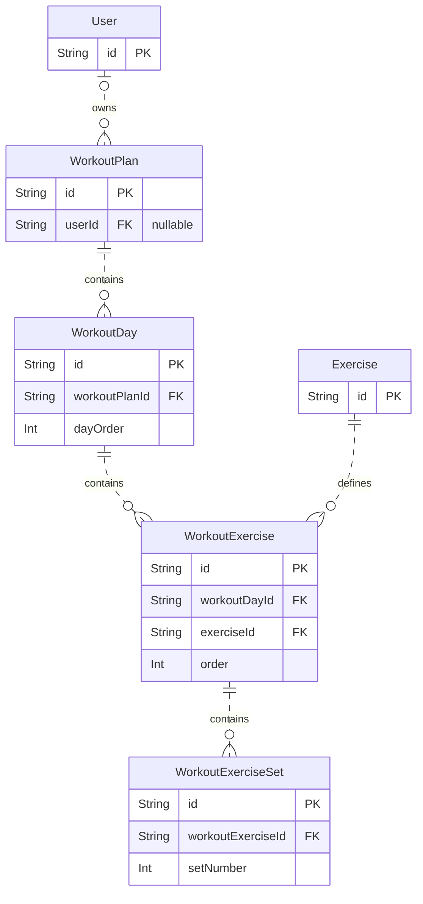
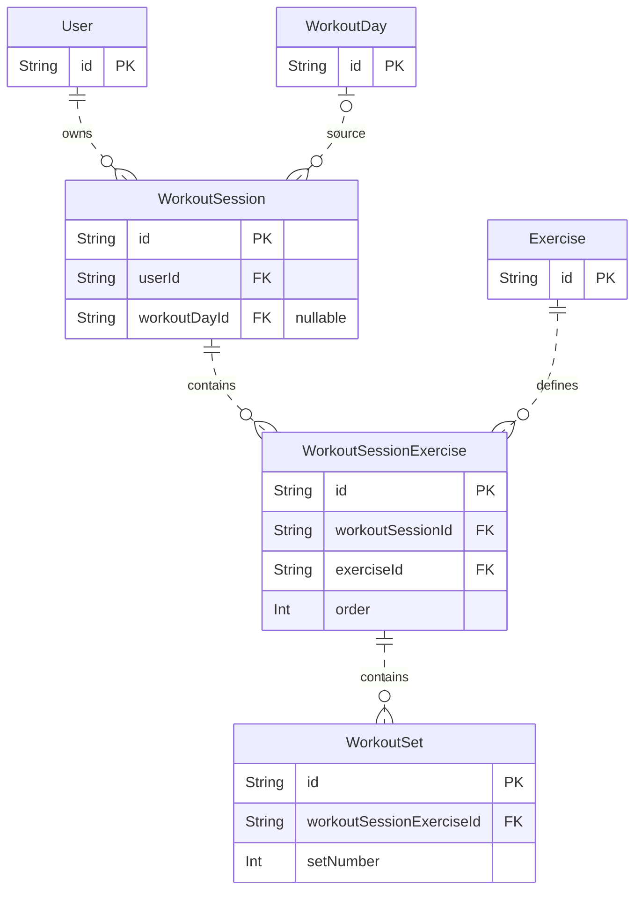
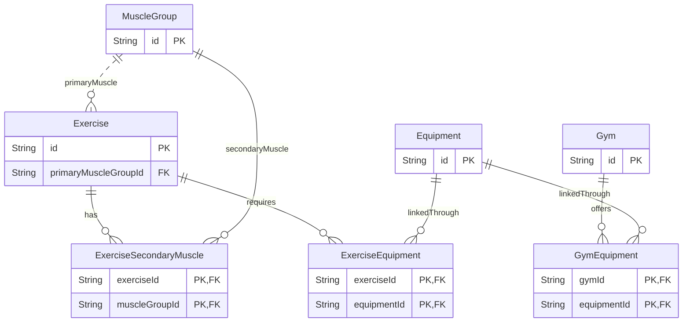

# Database relationship maps

These focused views describe the current [Prisma schema](../backend/prisma/schema.prisma), not feature implementation status. Fields unrelated to relationships are omitted. Update these maps when the schema changes.

## Open the diagrams

- In VS Code, open `backend/prisma/schema.prisma`, press `Ctrl+Shift+P`, and run **Show diagram** from Prisma ERD Visualizer (`bocovo.prisma-erd-visualizer`) for the full schema.
- For the focused diagrams, open this file and run **Markdown Preview Enhanced: Open Preview to the Side** if that extension is installed. GitHub also renders these Mermaid diagrams when viewing this file.

Read `||` as exactly one, `o|` as zero or one, and `o{` as zero or many. A foreign key (FK) is stored on the child. These diagrams use dashed lines for non-identifying relationships and solid lines when the parent's key is part of the child's primary key.

## Planning: reusable intent

A day contains exercise placements (`WorkoutExercise`), each referencing a catalog `Exercise`. Targets such as `targetReps` live on `WorkoutExerciseSet`.

`WorkoutPlan.userId` is nullable in the schema. Requiring a `CUSTOM` plan to belong to the authenticated user is an application rule; this diagram does not imply that unowned custom plans are valid product behavior.

The schema makes order unique within each parent: `(workoutPlanId, dayOrder)`, `(workoutDayId, order)`, and `(workoutExerciseId, setNumber)`.

## Execution: session and history

A session can have no source day. `WorkoutSet` holds separate planned snapshot fields (`plannedWeight`, `plannedReps`, `plannedDuration`, `plannedDistance`) and performed fields (`weight`, `reps`, `duration`, `distance`).

There is no foreign key from a session exercise or performed set to a planned exercise or planned set. The required start flow copies planned targets and relevant configuration into execution records; arrows in this diagram describe stored relationships, not that copy operation. Deleting a source day sets `WorkoutSession.workoutDayId` to null, preserving the session and its children.

The schema makes `(workoutSessionId, order)` and `(workoutSessionExerciseId, setNumber)` unique. Rejecting closed-session mutations and making completion idempotent are application requirements, not guarantees supplied by these relationships.

## Catalog: muscles and canonical equipment

Each exercise has exactly one primary muscle. Secondary muscles and equipment use join tables for many-to-many relationships. Each join table's two foreign keys form its composite primary key, preventing duplicate pairs.

S2 gyms and S3 exercises reference the same canonical `Equipment.id`. For example, a gym's available equipment can be compared with an exercise's equipment links without matching names.

## What deleting a parent does

These are the explicit `onDelete` rules for the relationships shown above. They apply when deleting the referenced parent, not when deleting the child.

| Parent deleted | Child foreign key | Result |
|---|---|---|
| `User` | `WorkoutPlan.userId`, `WorkoutSession.userId` | Cascade: delete the related plans/sessions and their cascading children |
| `WorkoutPlan` | `WorkoutDay.workoutPlanId` | Cascade: delete its days |
| `WorkoutDay` | `WorkoutExercise.workoutDayId` | Cascade: delete its planned exercises |
| `WorkoutExercise` | `WorkoutExerciseSet.workoutExerciseId` | Cascade: delete its planned sets |
| `WorkoutDay` | `WorkoutSession.workoutDayId` | SetNull: keep the session, clear its source-day reference |
| `WorkoutSession` | `WorkoutSessionExercise.workoutSessionId` | Cascade: delete its session exercises |
| `WorkoutSessionExercise` | `WorkoutSet.workoutSessionExerciseId` | Cascade: delete its performed sets |
| `Exercise` | `WorkoutExercise.exerciseId`, `WorkoutSessionExercise.exerciseId` | Restrict: reject deletion while referenced |
| `MuscleGroup` | `Exercise.primaryMuscleGroupId` | Restrict: reject deletion while used as a primary muscle |
| `Exercise` / `MuscleGroup` | `ExerciseSecondaryMuscle.exerciseId` / `muscleGroupId` | Cascade: delete the matching join rows |
| `Exercise` / `Equipment` | `ExerciseEquipment.exerciseId` / `equipmentId` | Cascade: delete the matching join rows |
| `Gym` / `Equipment` | `GymEquipment.gymId` / `equipmentId` | Cascade: delete the matching join rows |

For application invariants and schema commands, see [Database](database.md).
